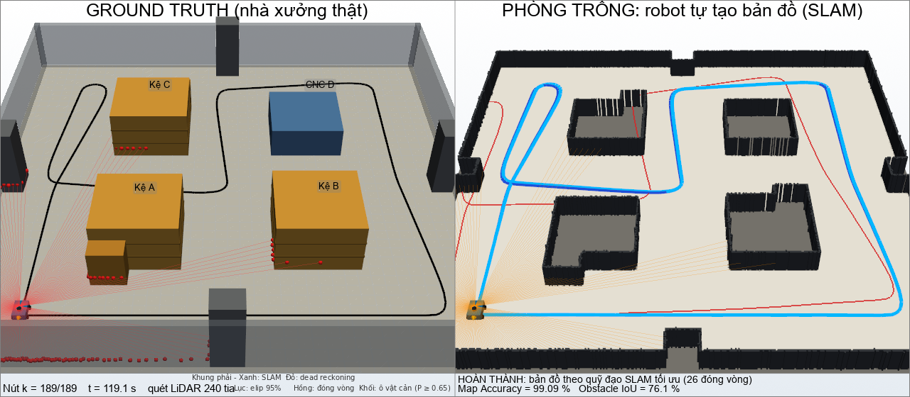

# LiDAR Pose-Graph SLAM cho robot AMR trong nhà xưởng

Mô phỏng và đánh giá định lượng **LiDAR Pose-Graph SLAM 2D** cho robot tự hành (AMR) tuần tra một nhà xưởng 20 m × 20 m. Kết quả gồm sai số tư thế với **hai đường biên tin cậy 95 % (±2σ)**, **elip 95 %**, kiểm định nhất quán Monte Carlo (NEES/ANEES) và độ chính xác bản đồ lưới chiếm chỗ.

Đồ án cuối kỳ học phần **Kỹ thuật Robot**.



## Tính năng

- **Quỹ đạo thật** sinh bằng mô hình Simulink `sl_drivepoint` (Corke et al., 2023 – RVC3 Toolbox), chạy qua 11 waypoint.
- **Mô phỏng cảm biến:** odometry có nhiễu, LiDAR 2D 240 tia / 12 m (dò tia trên bản đồ chuẩn).
- **So sánh 3 phương pháp:**
  - (A) Dead reckoning + EKF dự đoán;
  - (B) Ghép quét LiDAR không đóng vòng;
  - (C) Pose-Graph SLAM: ICP điểm–đường, phát hiện đóng vòng, tối ưu Gauss–Newton trên ma trận thông tin thưa H.
- **Độ bất định:** Σ = H⁻¹ → biên ±2σ, elip 95 % (χ²₂ = 5.991).
- **Đánh giá:** ATE, RPE, NEES/ANEES (Monte Carlo 20 lần), Map Accuracy, Obstacle IoU, độ nhạy theo nhiễu LiDAR σr = 1–8 cm, đối chiếu `lidarSLAM` (Navigation Toolbox).
- **Demo 3D hai khung (PyVista):** bên trái là ground truth; bên phải là phòng trống, nơi robot tự tạo bản đồ.

## Kết quả chính (σr = 3 cm, Monte Carlo 20 lần)

| Phương pháp | ATE RMSE | ANEES (kỳ vọng 2) |
|---|---|---|
| Dead reckoning | 0.873 m | 1.94 |
| Không đóng vòng | 0.097 m | 0.92 |
| **Pose-Graph SLAM** | **0.029 m** | 1.17 |

Bản đồ SLAM (lần chạy đại diện): Map Accuracy 99.09 %, Obstacle IoU 76.1 %. `lidarSLAM` (bật đóng vòng): ATE 0.122 m.

## Cấu trúc thư mục

```
PoseGraphSLAM_Project/
├── matlab/
│   ├── main_pose_graph_slam.m      # Chương trình chính: Simulink → SLAM → đánh giá → hình/CSV
│   ├── figures_matlab/             # Hình kết quả (dùng trong báo cáo)
│   └── results_matlab/             # results.json, traj_simulink.mat, csv/ (cho demo 3D)
├── python/
│   ├── demo_3d.py                  # Demo 3D hai khung (PyVista)
│   ├── pgslam_core.py              # Cài đặt Python độc lập (dùng chung hàm bản đồ cho demo)
│   ├── run_experiments.py          # Thí nghiệm bản Python (đối chiếu)
│   ├── demo_animation.py           # Animation 2D (matplotlib)
│   ├── make_diagrams.py            # Sơ đồ minh họa
│   └── build_report.py             # Dựng báo cáo Word từ kết quả MATLAB
├── figures/                        # Sơ đồ, ảnh/GIF demo
├── HUONG_DAN.md                    # Lý thuyết + cách làm + câu hỏi bảo vệ
└── KE_HOACH.md                     # Nhật ký công việc
```

## Yêu cầu

- **MATLAB R2020b trở lên** (đã thử trên R2024b), Simulink, Navigation Toolbox (chỉ cần cho phần đối chiếu `lidarSLAM`).
- **RVC3 Toolbox:** [petercorke/RVC3-MATLAB](https://github.com/petercorke/RVC3-MATLAB), đặt ở thư mục `../RVC3-MATLAB-main` (ngang hàng với `PoseGraphSLAM_Project`), hoặc sửa lệnh `addpath` ở đầu `main_pose_graph_slam.m`.
- **Python 3.10+** (đã thử 3.13): `numpy`, `matplotlib`, `pyvista`, `imageio`.

```bash
pip install numpy matplotlib pyvista imageio
```

## Cách chạy

**1. MATLAB:** tạo toàn bộ số liệu và hình, mất khoảng 10 phút.

```matlab
cd PoseGraphSLAM_Project/matlab
main_pose_graph_slam
```

- Tham số nằm ở mục `%% 0. THAM SỐ` (`P.sigma_r`, `P.M_mc`, `P.doMC`, `P.doAnimation`, …).
- Quỹ đạo Simulink được lưu đệm trong `results_matlab/traj_simulink.mat`. Xóa file này nếu bạn đổi waypoint.

**2. Demo 3D:** cần chạy bước 1 trước để có CSV.

```bash
cd PoseGraphSLAM_Project/python
python demo_3d.py                 # vừa chạy vừa tạo bản đồ
python demo_3d.py --mode after    # chạy hết vòng rồi mới dựng bản đồ
python demo_3d.py --follow        # camera bám robot
python demo_3d.py --save          # xuất GIF vào figures/
```

Trong cửa sổ demo: chuột để xoay/zoom (hai khung đồng bộ), phím `SPACE` để tạm dừng, đóng cửa sổ để thoát.

## Tài liệu tham khảo

1. G. Grisetti et al., "A tutorial on graph-based SLAM," *IEEE ITS Magazine*, 2010.
2. A. Elfes, "Using occupancy grids for mobile robot perception and navigation," *Computer*, 1989.
3. R. Kümmerle et al., "On measuring the accuracy of SLAM algorithms," *Autonomous Robots*, 2009.
4. W. Hess et al., "Real-time loop closure in 2D LIDAR SLAM," *ICRA*, 2016.
5. P. Corke, W. Jachimczyk, R. Pillat, *Robotics, Vision and Control: Fundamental Algorithms in MATLAB*, 3rd ed., Springer, 2023.
6. A. Censi, "An accurate closed-form estimate of ICP's covariance," *ICRA*, 2007.
7. Y. Bar-Shalom et al., *Estimation with Applications to Tracking and Navigation*, Wiley, 2001.

## Ghi chú

- Mô hình `sl_drivepoint.slx` và các hàm RVC3 thuộc bản quyền của tác giả RVC3 Toolbox. Repo này không kèm theo chúng; hãy tải từ repo gốc.
- Một phần mã nguồn được viết với sự hỗ trợ của công cụ AI (Claude). Nhóm đã kiểm tra và chịu trách nhiệm về kết quả.

## Tác giả

Phạm Huỳnh Đức, Huỳnh Phúc Thiện – Lớp 22DT4, Trường Đại học Bách khoa – Đại học Đà Nẵng.
GVHD: PGS.TS. Phan Trần Đăng Khoa.
